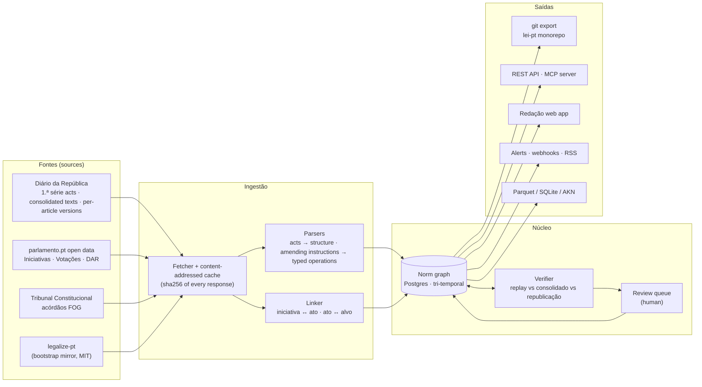

# Architecture

> **Decision in one line:** the source of truth is a **tri-temporal norm graph in Postgres**, built by a **hybrid pipeline**. That pipeline uses official republications and the DR's consolidated text as evidence, and replays amending acts for attribution. **Git is a deterministic export of that graph, not the database.**

Sources for this page: the architecture panel ([research/personas/architecture.md](research/personas/architecture.md)), the legislative panel's critique of the git metaphor ([legislative.md](research/personas/legislative.md)), and the source probes in [DATA-SOURCES.md](DATA-SOURCES.md).



## 1. The model: what a "version" is in Portuguese law

Git has one timestamp per commit. Portuguese law needs at least three dates per change, and a fourth axis for knowledge:

| Axis | Question it answers | Column |
|---|---|---|
| **Vigência** (valid time) | Which wording is in force on D? | `vigencia daterange` |
| **Eficácia** (efficacy) | Which wording governs facts that occurred on D? It is often retroactive (OE "a 1 de janeiro"), and is sometimes split by a norma transitória. | `eficacia daterange` (null = same as vigência) |
| **Conhecimento legal** (legal knowledge) | What could a diligent reader know on K? This is set by DR publication, a retificação or a TC acórdão. | `tx_legal tstzrange` |
| **Sistema** (system time) | What did *we* believe at time T? Kept for audit and corrections. | `tx_sistema tstzrange` |

**Worked example from real data:** CIRC art. 87.º, n.º 1 (taxa geral).

| Act | Published | In force | Rate in the text | Rate that applies |
|---|---|---|---|---|
| Lei n.º 45-A/2024 (OE2025), art. 90.º | 2024-12-31 | 2025-01-01 (its art. 335.º) | 20 % | periods starting on or after 2025-01-01 (art. 116.º, n.º 3) |
| Lei n.º 64/2025, art. 2.º | 2025-11-07 | 2025-11-12 (no date fixed → Lei 74/98 art. 2.º, n.º 2: 5.º dia) | 17 % | **19 %** for periods starting in 2026, **18 %** in 2027, **17 %** from 2028 (its art. 3.º) |

A naive "git log" view says the rate became 17% on 12 November 2025. That is wrong for every tax return until 2028. The model stores the text with `vigencia = [2025-11-12, )`. The transitional norm becomes three **efficacy effects** attached to the same unit, each with its own `eficacia` interval and substituted value. The article view shows them in the transitional-norm panel.

### Entities

FRBR mapping: **Diploma** = Work, **Versão** = Expression at a date, Markdown/AKN/PDF = Manifestations.

```sql
create table agente (id serial primary key, tipo text not null, nome text, sigla text, periodo daterange);
    -- órgão (AR, Governo, ALRA, TC, PR), grupo parlamentar, deputado; sigla changes over time

create table fonte (sha256 bytea primary key, url text, obtido_em timestamptz, mime text, bytes_ref text);
    -- every fetched response, content-addressed; everything downstream cites a fonte

create table diploma (
  id text primary key,                   -- 'lei/7/2009', 'dl/442-B/1988', 'crp/1976'
  tipo text, numero text, data_publicacao date, jornal text,   -- 'DR 1.ª série' | 'Diário do Governo'
  eli text unique,                       -- DR ELI (1.ª série from 1991)
  dr_id bigint, titulo text, emissor int references agente,
  e_codigo bool default false,           -- Lei 74/98 art. 6.º, n.º 3, a): codes exempt from republication trigger
  aprova_anexo text references diploma); -- the approving act vs the code in its annex

create table unidade (                   -- a LINEAGE: survives renumbering
  id uuid primary key, diploma_id text references diploma,
  tipo text check (tipo in ('parte','livro','titulo','capitulo','seccao','subseccao','divisao',
                            'artigo','numero','alinea','subalinea','anexo','preambulo')));

create table unidade_versao (
  id bigserial primary key, unidade_id uuid references unidade,
  pai_id uuid, ordem int[],              -- {5,1} sorts 5.º-A after 5.º
  rotulo text, eid text,                 -- '87.º', 'art_87__para_1'
  epigrafe text, texto text, tokens jsonb,  -- tokens carry efeito_id for word-level origin
  estado text,                           -- vigente|revogado|suspenso|caducado|inconstitucional
  vigencia daterange not null, eficacia daterange,
  tx_legal tstzrange not null, tx_sistema tstzrange not null,
  efeito_id bigint,
  exclude using gist (unidade_id with =, vigencia with &&, tx_legal with &&, tx_sistema with &&));

create type efeito_tipo as enum ('substituicao','substituicao_expressao','aditamento','revogacao',
  'renumeracao','suspensao','caducidade','repristinacao','inconstitucionalidade','retificacao',
  'republicacao','prorrogacao','eficacia_transitoria','interpretacao');

create table efeito (                    -- AKN textualMod / forceMod / efficacyMod
  id bigserial primary key,
  fonte_diploma text references diploma, fonte_eid text,      -- e.g. lei/64/2025 art_2
  alvo_diploma text references diploma, alvo_unidade uuid, alvo_rotulo text,
  tipo efeito_tipo, texto_antigo text, texto_novo text,
  data_vigencia date, eficacia daterange, condicao text,       -- 'períodos de tributação iniciados em 2026'
  regra_data text check (regra_data in ('explicita','supletiva_5_dias','transitoria','condicional','desconhecida')),
  estado text check (estado in ('identificado','aplicado','verificado','divergente','prospetivo')),
  extracao text, confianca real,                               -- 'grammar'|'llm:<model>'|'manual'
  fonte_sha bytea references fonte, tx_sistema tstzrange);

create table verificacao (id bigserial primary key, alvo_diploma text, data date,
  referencia text check (referencia in ('republicacao','consolidado_dr','legalize_pt')),
  resultado text, n_unidades int, n_exatas int, diff jsonb, corrido_em timestamptz);

create table iniciativa (id bigint primary key, legislatura text, tipo text, numero text, titulo text,
  autores int[], estado text, diploma_resultante text references diploma, ligacao text, ligacao_confianca real);
create table iniciativa_evento (iniciativa_id bigint, data date, fase text, obs text);
create table votacao (id bigint primary key, iniciativa_id bigint, fase text, data date, resultado text, unanime bool);
create table voto (votacao_id bigint, agente_id int, sentido text check (sentido in ('favor','contra','abstencao','ausente')));
create table proposta_alteracao (id bigserial primary key, iniciativa_id bigint, proponente int, alvo_rotulo text,
  texto text, resultado text, fonte_sha bytea);
```

### The queries the product needs

```sql
-- 1. "Texto em vigor a D, tal como conhecido a K" (default K = now)
select v.rotulo, v.epigrafe, v.texto
from unidade_versao v join unidade u on u.id = v.unidade_id
where u.diploma_id = $1 and v.vigencia @> $2::date
  and v.tx_legal @> $3::timestamptz and v.tx_sistema @> now()
order by v.ordem;

-- 2. "Regime aplicável a factos de D": same, on coalesce(eficacia, vigencia), then overlay
--    the eficacia_transitoria effects whose interval contains D and whose condition matches.

-- 3. Origem do texto (blame): tokens[] → efeito_id → efeito.fonte_diploma → iniciativa → votacao.
```

### Hard cases and how each is modelled

| Case | Model |
|---|---|
| Vacatio legis | `regra_data='supletiva_5_dias'`: 5.º dia after publication, counted from the day after the act is made available online (Lei 74/98 art. 2.º, n.os 2 e 4). Always shown as a computed date with the rule named. |
| Staggered entry into force | One act → several effects with different `data_vigencia`. In git, several commits `[1/3]` … `[3/3]`. |
| Retroactive or split efficacy (OE, transitional norms) | `eficacia_transitoria` effects. The text has one vigência; the efficacy carries conditions. |
| Declaração de retificação | Its effects reach back to the original's entry into force (Lei 74/98 art. 5.º, n.º 4). Close `tx_legal` on the wrong row and open a corrected row with the same `vigencia`. In git, a forward commit with a `Corrige-desde:` trailer. |
| Inconstitucionalidade com força obrigatória geral | Ex tunc by default, with `repristinacao` of the revoked norm (CRP art. 282.º, n.º 1). Time limits under n.º 4 go on the `eficacia` of the effect. |
| Cessação de vigência after apreciação parlamentar (CRP art. 169.º) | A `revogacao`-like effect whose source is a Resolução da AR. |
| Caducidade of temporary regimes | Scheduled `caducidade` effects (future vigência end), with alerts. |
| Renumbering, `5.º-A`, "(Revogado)" placeholders | Lineage `unidade` plus a versioned `rotulo`. Similarity-based lineage matching across republications, confirmed by a person. |
| Omnibus acts (OE amending 30+ diplomas) | One `diploma` (the act) → N effects on N targets. One git commit across many directories in the monorepo. |
| Code in an annex | `diploma.aprova_anexo`. Units belong to the annex Work; alteration ordinals are counted against the code. |
| Implicit repeal ("revoga as normas contrárias") | Never applied automatically. Stored as an `identificado` effect with no target, shown as "possível revogação tácita — juízo do intérprete". |
| Pending initiatives | `prospetivo` effects attached to a `proposta_alteracao` or a texto de substituição; never merged into `vigente` rows. |

## 2. Ingestion: strategy C (hybrid)

Evidence ranks, strongest first:

1. **Republicação** annexes. These are official and part of a published act. They are mandatory for the CRP, organic laws, framework laws and Lei 74/98 itself (art. 6.º, n.º 2), and for laws with more than 3 amendments or more than 20% of the articulado amended (n.º 3; codes excepted). **OE amendments are never republished** (n.º 5), so for the tax codes there is often no official full-text checkpoint.
2. **DR consolidated text.** Editorial, "sem valor legal", and possibly protected as a compilation (CDADC art. 3.º, n.º 1, c)), so we use it to *verify* rather than redistribute. Its per-article versions with `DataEntradaVigor` and the amending act ("Alterado pelo/a Artigo 2.º do/a Lei n.º 9/2010 …, em vigor a partir de 2010-06-05") are exposed by the site's internal API ([DATA-SOURCES.md](DATA-SOURCES.md)).
3. **Our replay** of amending instructions. It gives attribution down to the word, dates and explanation. The published corpus is built from this replay of the official acts, which are not protected by copyright (CDADC art. 8.º). A first test on Lei 13/2023 → Código do Trabalho reproduced 90 of 97 articles exactly with 5 rules.

Pipeline per amending act:

1. **Fetch** the act (DR detail plus PDF/HTML) into the content-addressed cache.
2. **Segment** into articles and identify amending instructions. The deterministic grammar covers the common forms:
   - «O artigo 87.º do Código do IRC passa a ter a seguinte redação:» (substituição, with `[...]` = unchanged número)
   - «É aditado o artigo 5.º-A …» (aditamento)
   - «São revogados …» (revogação)
   - «No n.º 2 …, a expressão «X» é substituída por «Y»» (substituição de expressão)
   - «É republicado em anexo …» (republicação → verification checkpoint)
   - «… aplica-se aos períodos de tributação que se iniciem em ou após …», «produz efeitos a …» (eficácia)
   - «A presente lei entra em vigor …» (vigência; absent → supletiva)
3. **LLM fallback** only emits structured operations `{tipo, alvo, rotulo, texto_ref}`. Hard invariant: every inserted character must be a verbatim span of the source act. The model selects text; it never writes it.
4. **Apply** the operations to the previous version of each target unit.
5. **Verify** against the next evidence point (a republicação, otherwise the DR consolidated version for that article and date). Exact match after normalisation → `verificado`. A mismatch → `divergente` plus a diff in the human review queue. Divergences are never resolved automatically.
6. **Attribute** tokens: a word-level diff between consecutive versions of the same lineage carries `efeito_id` forward.

Bootstrap: for diplomas we have not replayed yet, serve the DR consolidated per-article versions as Strategy A (subject to INCM's position on reuse), or the original acts. Label them *"Texto consolidado — atribuição por verificar"*. Note that the DR leaves `DataProducaoEfeitos` empty even when a transitional norm exists (CIRC art. 87.º after Lei 64/2025), so efficacy always comes from parsing the acts.

### Verification metrics, published per diploma

| Metric | Definition | MVP target |
|---|---|---|
| M1 | Version transitions reproduced exactly by replay (after normalisation) | ≥ 97% (Lexifina: 361/365 ≈ 98.9%). Measured for the CRP on 2026-10-28: 70.8% of the articles the 7 revisions changed; see below |
| M2 | Per-article exact match at each republication | ≥ 99% (measured for the DR consolidated CRP on 2026-10-28: 96.6% of 994 versions; see below) |
| M3 | Alteration-ordinal chain consistent with Lei 74/98 art. 6.º, n.º 1 ("k.ª alteração" = k−1 known amenders) | 100% or listed as a gap |
| M4 | Share of tokens attributed to a specific effect | ≥ 95% for post-1991 acts |
| M5 | Date provenance mix: explícita / supletiva / transitória / desconhecida | Always reported, never hidden |
| M6 (gate) | Release blocked when M1 or M2 drops below target, as sejm2git does with `--fail-under` | CI |
| M7 | Iniciativa → ato linkage rate | ≥ 99% (measured: 136/136 for the XVII legislature via `TextosAprovados`; 99.4% across all legislaturas) |

**Decision on 2026-10-28: the app uses the DR consolidated text for now.** It is the only source with every version of every article and its dates. The caveat is stated on the app's "Sobre os dados" page: the consolidated text has no legal value and can differ from the official texts. Where a republication exists (the CRP), each version shows the result of the check below. Replacing consolidated text with our replay waits until M1 is high enough.

### First measurement: the DR consolidated CRP against its 8 official texts (2026-10-28)

`pipeline/verificacao.py` compares every consolidated version of every CRP article with the official texts in its period: the 1976 text and the republication in each of the 7 revisions. Results are in `app/data/verificacao.json` and on the app's Verificação page.

| Verdict | Versions | Meaning |
|---|---|---|
| igual | 939 | Same text as at least one republication, and no run of later republications disagrees |
| só na forma | 21 | Same words; punctuation, capitals or line breaks differ |
| desatualizada | 5 | Matches the first republications, then every later one has other words: the DR missed a change (arts. 5.º, 84.º, 179.º, 196.º, 280.º) |
| divergente | 29 | No republication has this text. Some are DR typos ("inviolával", art. 24.º), some are slips in the digital transcription of the old acts ("Constitutição"). A person must check each against the PDF |

Per republication, 89–100% of articles match. The older acts (1982–1992) were transcribed from print and have their own slips, so a version counts as verified when one republication matches and no later run disagrees. The DR history also follows today's numbering: 36 articles of the older texts (17 of them from 1976) have no history at all.

This is M2 for the consolidated text, not for our replay.

### First replay: the 7 revisions of the CRP (M1, 2026-10-28)

`pipeline/replay.py` applies each Lei Constitucional to the previous official text and compares the result with the act's own republication. It reads the instructions with fixed rules and no language model, so every inserted word comes from the act. References use the numbers before the revision, so each unit keeps its original label. Two things the drafters leave implicit are done the way the republications do them: an inserted alínea pushes the next ones down, and references to moved articles take the new numbers.

| Revision | Instructions (unread) | Changed articles reproduced | Unchanged articles equal (ceiling) |
|---|---|---|---|
| 1/82 | 523 (7) | 146 / 213 (68.5%) | 86.2% |
| 1/89 | 416 (8) | 114 / 174 (65.5%) | 89.5% |
| 1/92 | 10 (0) | 4 / 6 (66.7%) | 93.2% |
| 1/97 | 509 (14) | 168 / 236 (71.2%) | 92.1% |
| 1/2001 | 11 (0) | 6 / 6 (100%) | 96.6% |
| 1/2004 | 108 (3) | 43 / 45 (95.6%) | 98.8% |
| 1/2005 | 2 (0) | 2 / 2 (100%) | 100% |

The ceiling column matters: even articles a revision did not touch differ between two consecutive official texts in 1–14% of cases, because the older acts were transcribed from print. The same slips hit the changed articles. The rest of the gap is in the republications themselves: they change punctuation, verb tenses and wording that the act does not mention (1997: "protegerá" became "protege"). The born-digital revisions (2001–2005) replay almost exactly.

The gate (M6) is a test: `pipeline/test_pipeline.py` fails when M2 drops below 96% or M1 below 70%.

## 3. Text normalisation

- The canonical form is a JSON tree with AKN-style eIds, aligned with the draft AKN-PT profile (`dapl-sggov/akn-pt`, with ELI-PT URIs on data.dre.pt). Track that profile as it moves towards institutional validation. Example eIds: `art_87__para_2`, `art_5-A__para_2__point_b__subpoint_ii`. Markdown and AKN XML are renders.
- Unicode NFC. `º` (U+00BA), never `°`. Unify `n.º`/`n.o` and `n.os`/`n.<sup>os</sup>`. Number dashes `1 -`, `1 –`, `1 —` → `1 —`. Keep `«»`. Collapse whitespace. Repair PDF hyphenation. Keep pre-1990 spelling as published (*efectuado*, *direcção*), since spelling changes are not amendments.
- Tables (CIRS brackets, OE maps) are structured cells, never flattened text. *Prototype: one line per row, cells split by `│`, merged cells filled so rows of a table line up (`pipeline/texto.py`); the app draws them as a grid.*

## 4. Git export (`lei-pt`)

Git is rebuilt deterministically from the database with `git fast-import`. The same database state always yields the same commit hashes.

### Layout: one monorepo, one file per article

```
lei-pt/
  README.md
  crp/1976/_diploma.yaml                     # ELI, títulos, ordering of units, aliases
  crp/1976/artigos/0001.md
  codigo-trabalho/lei-7-2009/artigos/0040.md
  codigo-irc/dl-442-B-1988/artigos/0087.md
  codigo-civil/dl-47344-1966/artigos/1577.md
  _atos/lei-64-2025.yaml                      # the amending act: effects, dates, links
```

- One file per article: diffs stay short, `git log -- <file>` is the article's history, and `git mv` expresses renumbering.
- Front matter: `id`, `rotulo`, `epigrafe`, `estado`, `vigencia`, `eli`. Then **one número or alínea per line**, so line-based tools behave.
- Revoked articles keep their file with `*(Revogado.)*`, as the DR does.

### Commits

**Commit = (ato modificador × distinct vigência date).** One act with three entry dates → three commits `[1/3]` … `[3/3]`. One act touching several codes → one commit across their directories.

```
Lei n.º 64/2025, de 7 de novembro — altera o Código do IRC (artigo 87.º)

Altera as taxas gerais do IRC (n.os 1, 2 e 5 do artigo 87.º).

Author:     Assembleia da República <ar@lei-pt.invalid>    date: 2025-11-12 (vigência)
Committer:  lei-pt <bot@lei-pt.invalid>                    date: 2025-11-07 (publicação)

Diploma: lei/64/2025
ELI: https://data.dre.pt/eli/lei/64/2025/11/07/p/dre/pt/html
Publicacao: 2025-11-07
Vigencia: 2025-11-12
Regra-data: supletiva_5_dias (Lei 74/98, art. 2.º, n.º 2)
Eficacia: art_87__para_1,para_5 = 19% @ periodos-2026; 18% @ periodos-2027; texto @ periodos>=2028
Eficacia: art_87__para_2 = texto @ periodos>=2026
Iniciativa: PPL 16/XVII
Votacao-final-global: 2025-10-17 aprovado | favor PSD CH IL CDS-PP PAN JPP | contra PS L PCP BE
Verificacao: consolidado-DR exata (3/3 números)
```

| Git concept | Meaning in `lei-pt` |
|---|---|
| `main` | Text in force today. Only commits with vigência ≤ today, in vigência order. Never rewritten. |
| `prospetivo` | Rebuilt daily: `main` plus published-but-not-yet-in-force effects (houritsu's `upcoming` branch is the same idea). |
| `iniciativas/XVII/PPL-16` | The proposal's text applied to `main`. **Never merged**: the law that results is a separate commit that links back with `Iniciativa:`. Archived at caducidade. |
| `edicoes/2026-10-28` | A full valid-time-ordered reconstruction as known on that date. Retroactive corrections show up between editions, not by rewriting `main`. |
| tags | `crp/rev-1982`, `crp/rev-1989`, … `crp/rev-2005`; `republicacao/<diploma>/<data>`; `alteracao/<diploma>/<n>` |
| author date / committer date | vigência / publicação. Pre-1970 dates (Código Civil 1966, Diário do Governo) are clamped to 1970-01-01 in the header; the true date goes in trailers. |

Efficacy, retroactivity and transitional norms live in trailers and in the database. Git is for browsing and bulk use; the API answers legal questions.

## 5. API and MCP

All read endpoints require an explicit date. There is no implicit "today" on the API.

```
GET /v1/texto/{eli}/{fragmento}?em=2026-03-01&base=vigor|efeitos|publicacao&conhecido_em=
GET /v1/comparar/{eli}/{fragmento}?de=2025-06-01&ate=2026-03-01          # word diff JSON, HTML redline, unified diff
GET /v1/origem/{eli}/{fragmento}?em=                                       # spans → efeito → ato → iniciativa
GET /v1/historia/{eli}/{fragmento}                                          # versions with all dates and verification
GET /v1/atos/{eli}                                                          # an amending act: effects, dates, initiative, votes
GET /v1/iniciativas/{leg}/{tipo}/{n}                                        # process, votes, texts, simulated effects
GET /v1/alteracoes?desde=cursor&lista=                                      # change feed
POST /v1/webhooks                                                           # publicado | alterado | entra-em-vigor | produz-efeitos | retificado | caduca
```

Every response carries `{content_sha256, commit, fonte_url, fonte_sha256, verificacao, regra_data, avisos[]}`. `avisos[]` includes cases like "a later act has retroactive effect on this period", "transitional regime applies" and "text not verified".

MCP tools, few and typed, with time always explicit:

```
obter_norma(ref: "CIRC art. 87.º n.º 1", data: "2026-03-01", base: "efeitos")
  -> {texto, eli, fragmento, versao: {de, ate}, transitorias[], verificacao, fonte_url, sha256, avisos[]}
pesquisar(consulta, data, diplomas?)      comparar(ref, de, ate)      origem(ref, data)
alteracoes(desde, refs[])                  resolver_referencia("art. 88.º do CIRC") -> eli + fragmento
```

## 6. Stack

| Concern | Choice | Why |
|---|---|---|
| Fetch and parse | Python 3.12, `httpx`, `selectolax`, `pydantic` | The DR site is an OutSystems SPA with JSON endpoints; Python suits the parsing work. |
| Store | Postgres 16 + `btree_gist`, `pg_trgm`, `unaccent` | Range types and exclusion constraints give the tri-temporal model; full-text search in Portuguese. |
| Orchestration | Simple queue (Postgres `SKIP LOCKED`) + cron | A daily DR issue is about 50–200 acts; no big-data tooling needed. |
| Diff | Token-level Myers/patience (`diff-match-patch` on word tokens) | Word-level origin and redlines. |
| Git export | `git fast-import` stream | Deterministic and fast; about 0.5M files across the full corpus. |
| API | FastAPI + an MCP server on the same service layer | One code path for people and agents. |
| Web | Server-rendered pages (Astro or SvelteKit) with islands for the DateLens, redline and origin | SEO for article pages, fast on phones, accessible without JS for reading. |
| Search | Postgres FTS (Portuguese) + a curated synonym layer ("lei das rendas" → NRAU) | Citizen queries are colloquial. |

## 7. Scale (estimates, measured in Phase 0)

- DR 1.ª série: roughly 2.5k–4k acts per year. The legalize-pt mirror holds about 172k acts and 131k reforms since 1960.
- Diplomas with DR consolidation: low thousands. MVP corpus: under 50k `unidade_versao` rows. Full corpus: a few million rows.

## 8. Risks

1. **Source access.** The DR has no documented API; the internal OutSystems endpoints can change. Mitigate with a content-addressed cache, contract tests on the endpoints, the legalize-pt fallback, and a request to INCM for bulk access. DL 83/2016 guarantees open, free access to DR content.
2. **The long tail of amending phrasing.** Expression substitutions, "com as necessárias adaptações", annex and table changes. Mitigate with grammar coverage metrics, the LLM-as-selector fallback and human review.
3. **Identity under silent renumbering** in republications. The CIRC was renumbered in 2009, and in the legalize-pt snapshot we inspected its file still carries the 1988 text. This is exactly what verification must catch.
4. **Date semantics.** Conditional, transitional and retroactive dates are the core risk. Use explicit `regra_data`, never a silent default.
5. **Initiative ↔ act linkage.** Solved for laws: `TextosAprovados` → Diplomas Aprovados gives the exact act (99.4%). The residual risk is the three legislative sessions missing from the open data, and the many-to-one cases (789 of 4,188 laws come from several initiatives), where attribution must go through the texto final.
6. **Neutrality.** Measure vote-parsing error rates per group.
